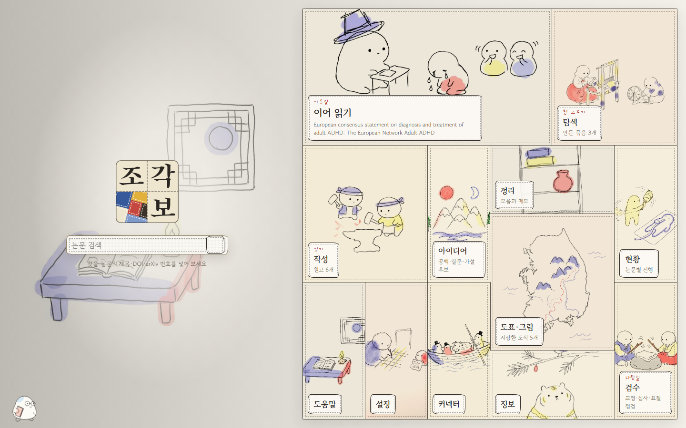

<p align="center"></p>

# 조각보 (Jogakbo) 데모

**검색 사이트, PDF 뷰어, 서지 관리, 워드. 논문 한 편에 창이 네 개.**

조각보는 찾은 논문과 읽은 문장이 원고의 인용까지 이어지는 논문 프로그램이에요.

논문 탐색 · PDF 읽기 · 정리 · 원고 작성 · 인용 검증



> 지금 판은 아는 분들께 먼저 보여 드리는 **데모**예요. 고칠 점이나 바라는 기능은 앱의 **문의(신문고)** 탭이나 goldeye3333@gmail.com으로 알려 주세요.

## 이럴 때 써요

### 창을 몇 개씩 띄워 놓고 일할 때

탐색, 읽기, 정리, 작성, 검수가 한 프로그램 안에 있어요. 검색 결과에서 고른 논문을 그 자리에서 열어 읽어요. 읽다가 표시한 문장은 기록에 모여서 원고를 쓸 때 다시 꺼내 볼 수 있어요.

### 읽은 문장을 다시 못 찾을 때

형광펜과 메모에는 어느 논문 몇 쪽인지가 함께 남아요. 기록에서 문장을 누르면 PDF의 그 자리가 열려요. 현황에서는 논문마다 어디까지 읽고 정리했는지 보여요.

### 중요한 논문을 빠뜨렸을까 봐

주제나 논문 하나에서 출발해 관련 논문을 묶음으로 찾아요. 그 논문이 인용한 연구와 그 논문을 인용한 연구를 여러 단계 따라갈 수 있어요. 인용 관계가 없어도 내용이 비슷한 연구를 함께 찾아요. "빠진 논문 점검"은 이 검색이 놓칠 수 있는 곳과 더 찾아볼 사이트를 알려 줘요.

한국어 논문은 KCI로 찾아요. 본인의 KCI 인증키가 필요하고 아직 시험 단계예요.

### 참고문헌을 끝에 몰아서 맞출 때

LaTeX와 Markdown 원고를 쓰고 컴파일해요. 인용 검증은 원고에 적힌 서지가 실제 논문과 맞는지 확인해요. 자동 점검은 없는 참조나 짝이 안 맞는 괄호를 찾아요.

### 논문과 원고를 밖에 두기 찜찜할 때

조각보는 내 컴퓨터에서 돌아가요. 논문 PDF, 원고, 읽기 기록은 내 컴퓨터에만 저장돼요. AI 기능을 쓸 때만 그 내용이 고른 AI 서비스로 가요.

### AI를 쓰고 싶을 때

번역, 요약, 질문, 교정, 가상 심사는 단추를 누를 때만 AI를 불러요. AI가 한 말에는 원문 쪽수가 붙어요. 본인의 API 키를 넣거나, 키가 없으면 앱에서 조각보 연동을 요청해 운영자 승인을 받아 쓸 수 있어요.

키가 없어도 "한눈에" 탭과 자동 점검처럼 AI 없이 되는 기능은 그대로 쓸 수 있어요.

## 필요한 것

| | Windows | Mac |
|---|---|---|
| 운영체제 | Windows 10·11 (64비트) | macOS 11 이상, Apple Silicon(M1 이후) |
| 디스크 여유 | 2GB 이상(설치하면 약 1.6GB) | 3.5GB 이상(설치하면 약 2.2GB) |

- 인터넷 연결(논문 검색, AI 기능)
- AI 기능을 쓰려면 본인의 API 키(예: Anthropic, OpenAI)나 조각보 연동 승인
- Intel Mac용은 아직 없어요.

## 설치

오른쪽 **Releases**에서 가장 위 판을 열고 내 컴퓨터에 맞는 파일을 받아요.

### Windows

1. `Jogakbo_…_x64-setup.exe`를 받아 두 번 눌러 실행해요.
2. **"Windows의 PC 보호"** 창이 뜨면 **추가 정보**를 누른 뒤 **실행**을 눌러요.
   데모 판은 코드 서명을 하지 않아 Windows가 "게시자를 알 수 없음"으로 경고해요. 이 저장소의 Releases에서 받은 파일이면 실행해도 돼요.
3. 한국어 설치 화면을 따라가요. 관리자 권한은 묻지 않고 내 계정에만 설치돼요.
4. 시작 메뉴에서 **Jogakbo**를 열어요. 처음 열 때는 준비하느라 조금 걸려요.

WebView2 런타임이 없는 PC라면 설치 중에 자동으로 받아요.

### Mac

1. `Jogakbo_…_aarch64.dmg`를 받아 열고 **Jogakbo**를 **응용 프로그램** 폴더로 끌어 놓아요.
2. 응용 프로그램에서 Jogakbo를 열어요. "열 수 없습니다" 창이 뜨면 **완료**를 눌러요.
   데모 판은 Apple의 확인(공증)을 받지 않아 처음 한 번은 macOS가 막아요.
3. **시스템 설정 → 개인정보 보호 및 보안**으로 가서 아래쪽의 **그래도 열기**를 눌러요.
4. 다시 한 번 **열기**를 누르면 그다음부터는 바로 열려요.

Mac 판은 빌드 서버에서 설치 파일을 열어 앱이 뜨는 데까지만 확인했어요. 안 되는 곳이 있으면 꼭 알려 주세요.

## 처음 쓸 때

- 첫 화면에 안내 창이 떠요. **둘러보기**를 누르면 바늘이 화면을 돌며 기능을 하나씩 알려 줘요.
- 메뉴 탭에 처음 들어갈 때마다 그 탭의 둘러보기가 떠요. 도움말에서 다시 볼 수 있어요.
- **시작 안내**에서 AI 연결을 고르고 API 키를 넣어요. 키는 Windows 자격 증명 관리자(Mac은 키체인)에만 저장되고 다른 곳으로 보내지 않아요.
- AI 기능은 단추를 누를 때만 불러요. 논문을 열기만 해서는 요금이 들지 않아요.

## 업데이트

- **Windows**: 새 판이 나오면 앱을 열 때 "새 판이 있어요" 창이 떠요. **예**를 누르면 받아서 설치하고 다시 열려요.
  1.2.0-demo부터는 **정보** 화면의 **최신 판인지 확인** 단추로도 확인할 수 있고 받는 동안 진행률이 보여요.
  1.1.0-demo에서 올라올 때는 받는 동안 표시가 없어요. 몇 분 걸리니 앱을 끄지 말고 기다려 주세요.
- **Mac**: 아직 앱 안에서 자동으로 업데이트되지 않아요. Releases에서 새 `.dmg`를 받아 응용 프로그램 폴더의 Jogakbo를 바꿔 주세요.

어느 쪽이든 내 논문, 원고, 설정은 그대로 남아요.

## 지우기

### Windows

**설정 → 앱 → 설치된 앱 → Jogakbo → 제거**를 눌러요.
앱은 지워져도 내 자료(논문 PDF, 원고, 읽기 기록)는 `%LOCALAPPDATA%\paper-scout` 폴더에 남아요. 완전히 지우려면 그 폴더도 지워 주세요. 저장한 API 키는 Windows **자격 증명 관리자**에서 `paper-scout`로 시작하는 항목을 지우면 돼요.

### Mac

응용 프로그램 폴더의 **Jogakbo**를 휴지통으로 옮겨요.
내 자료는 홈 폴더의 `~/.local/share/paper-scout`에 남아요. 완전히 지우려면 그 폴더도 지워 주세요(Finder에서 **이동 → 폴더로 이동**에 경로를 넣으면 열려요). 저장한 API 키는 **키체인 접근** 앱에서 `paper-scout`를 검색해 지우면 돼요.

## 받은 파일 확인(선택)

Release에 있는 `SHA256SUMS.txt`의 값과 받은 파일의 값을 비교할 수 있어요.

Windows PowerShell:

```powershell
Get-FileHash .\Jogakbo_1.3.1-demo_x64-setup.exe -Algorithm SHA256
```

Mac 터미널:

```bash
shasum -a 256 Jogakbo_1.3.1-demo_aarch64.dmg
```

## 판 기록

앱의 "새 소식" 창에서 **바뀐 내용 모두 보기**를 누르면 이 절로 와요.

### 1.3.1-demo

- **조각보 연동 요청**: API 키가 없어도 운영자가 승인하면 Claude를 쓸 수 있어요. 설정 > AI 연결·키에서 "조각보 연동"을 고르고 이름, 연락처, 쓰려는 용도를 적어 보내요. 승인되면 이번 달 사용액과 한도가 보여요.
- 고친 것: Anthropic API 키를 넣어도 AI 기능이 동작하지 않던 문제.
- Mac 판도 함께 나왔어요.

### 1.3.0-demo

Windows 판만 나왔어요. Mac은 1.3.1-demo를 받아 주세요.

- **한눈에 탭**: 논문을 열면 AI 없이도 목차, 초록의 목적·방법·결과 문장, 기여·한계 문장, 약어, 숫자가 든 문장, 코드·데이터 링크, 참고문헌별 인용 문맥이 읽기 화면 첫 탭에 보여요.
- **참고문헌 찾기**: AI 없이 참고문헌 줄을 실제 논문에 이어요. 못 찾은 줄만 AI에 맡길 수 있어요.
- **자동 점검·투고 전 점검표**: 검수에서 없는 참조·인용, 짝이 안 맞는 괄호, 표기 흔들림 등을 AI 없이 찾아요.
- **화면 동료**: AI를 연결하면 화면 아래에 캐릭터가 나타나 말로 시키는 일(화면 이동, 검색, 문서 열기 등)을 도와요. 끌어서 옮길 수 있어요.
- 탐색: 인용 밖의 비슷한 연구 찾기, 검색 조건 체크박스, 빠진 논문 점검 안내.
- 화면: 새 로고와 시작 화면, 한지 결과 구역 구분.
- 고친 것: 실행할 때마다 둘러보기·검색 조건이 초기화되던 문제, 작업 취소가 사라지던 문제, 새 소식 창이 시작 안내 위에 겹치던 문제.

### 1.2.0-demo

- 읽기 목록에 **내 PDF 넣기** 단추가 생겼어요. 사이트가 자동 내려받기를 막아 받지 못한 논문을 브라우저로 직접 받은 PDF로 넣어 읽을 수 있어요. 논문 ID를 적어 두고 넣으면 그 논문에 붙어요.
- 논문을 받지 못했을 때 그 방법을 알려 주는 안내 문구가 나와요.
- 정보 화면이 설치한 판 번호(예: 1.2.0-demo)를 보여 줘요.
- 정보 화면에 **최신 판인지 확인** 단추가 생겼어요. 새 판이 있으면 판 설명을 보고 바로 업데이트할 수 있어요(Windows).
- 업데이트를 받는 동안 진행률(%, MB)이 보여요. 전에는 받는 동안 아무 표시가 없었어요.
- 바탕화면·작업 표시줄·설치 창의 아이콘과 불러오는 화면이 조각보 로고로 바뀌었어요.

### 1.1.0-demo

- Mac(Apple Silicon) 판이 처음 나왔어요.
- 메뉴 탭마다 처음 들어갈 때 둘러보기가 떠요. 읽기, 원고 편집, 검수 같은 작업 화면에도 둘러보기가 생겼어요. 도움말에서 다시 볼 수 있어요.
- 탐색: 검색 조건·정렬, 여러 출처 검색, 인용 관계를 여러 단계 따라가는 인용 탐색.
- 한국어 논문 검색 출처(KCI). 본인의 KCI 인증키를 넣어야 하고 아직 시험 단계예요.
- 논문 옆에 피인용 수, 철회 여부, 오픈액세스 표지 같은 지표와 발표처 정보가 보여요.
- 읽기 화면에 인용 탭(인용한 논문·인용된 논문)이 생겼어요.
- AI 없이 도식을 만드는 단추, Zotero 컬렉션에서 단계형 탐색 시작하기.
- 모음과 원고의 이름 바꾸기·지우기.

### 1.0.0-demo

- 첫 데모(Windows).
